

  

# Edulith

Edulith is an AI study platform I designed, built and ran on my own from November 2024 to October 2026. It combines a step by step math solver, a calculator with a math keyboard, AI chat, flashcards, image generation and a shared library of study material. It runs as a mobile app (iOS and Android), a web app and a desktop app, all backed by one API.

> **Last worked on: June 2026.** Active development ran from November 2024 to June 2026 (last development push 11 June 2026, version 1.0.6). The business was wound down in October 2026.

This repository is a showcase. The production source code is private.

## Screenshots

<table>
  <tr>
    <td align="center">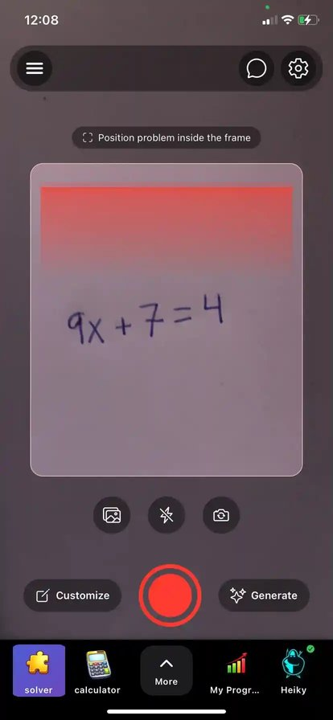 Solver with camera input</td>
    <td align="center">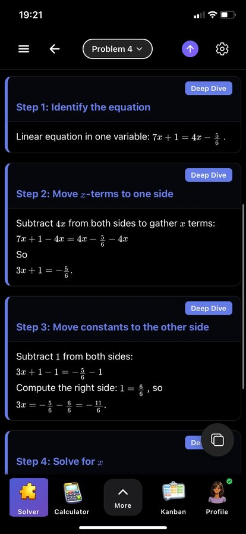 Step by step solutions</td>
    <td align="center">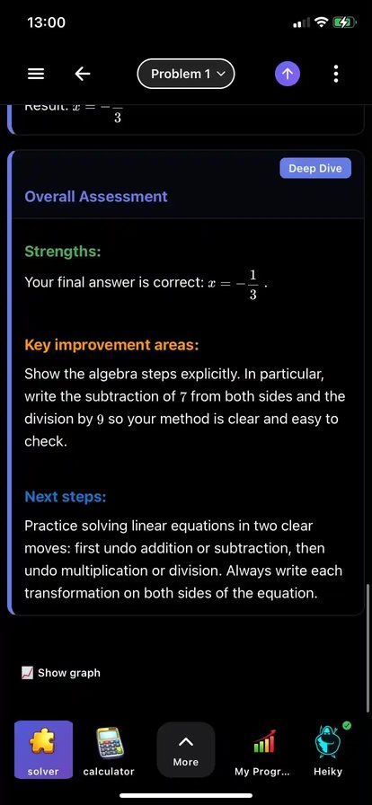 Feedback on your own work</td>
    <td align="center">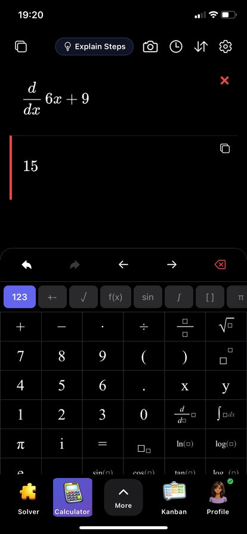 Calculator with math keyboard</td>
  </tr>
  <tr>
    <td align="center">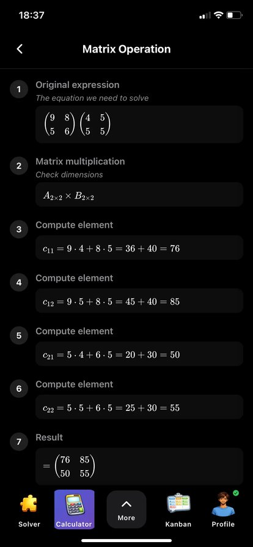 Matrix operation with steps</td>
    <td align="center">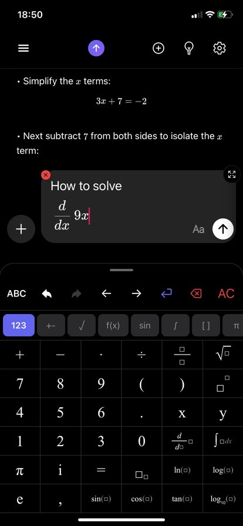 AI chat with rendered math</td>
    <td align="center">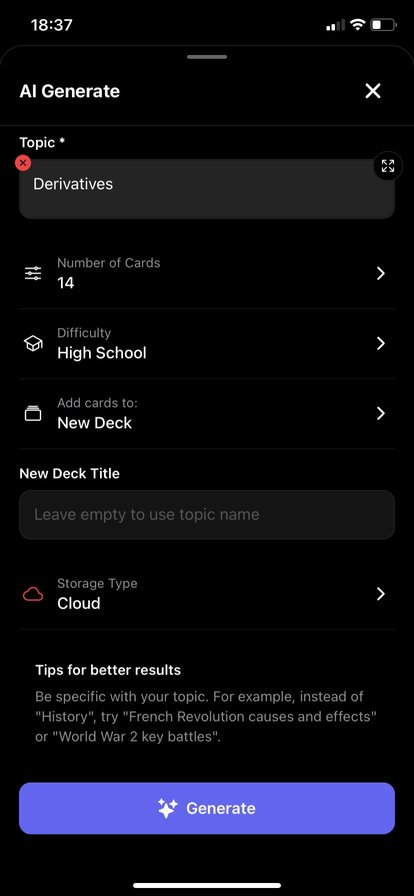 AI generated flashcards</td>
    <td align="center">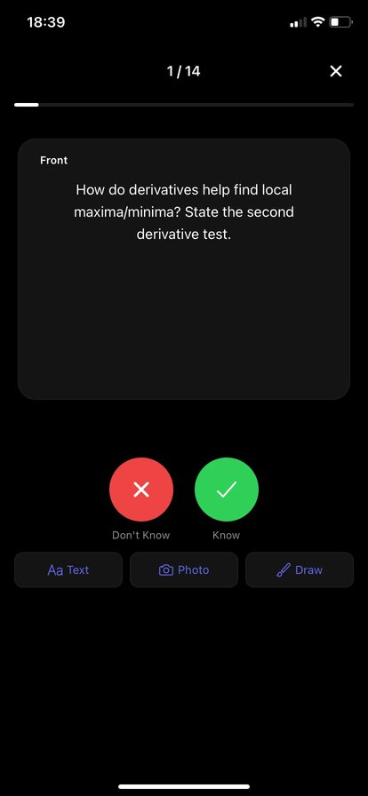 Flashcard study mode</td>
  </tr>
  <tr>
    <td align="center">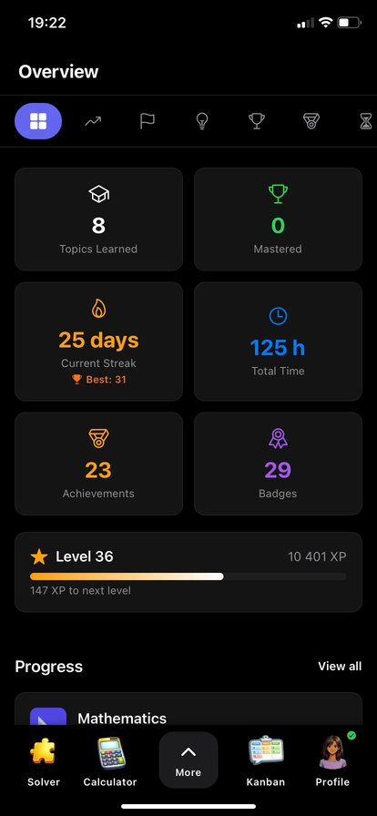 Progress and achievements</td>
    <td align="center"> Friends and presence</td>
    <td align="center">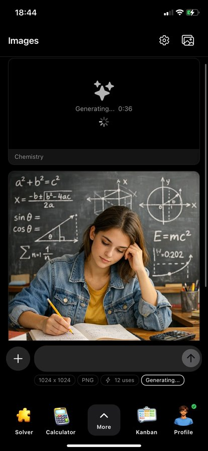 Image generation</td>
    <td align="center">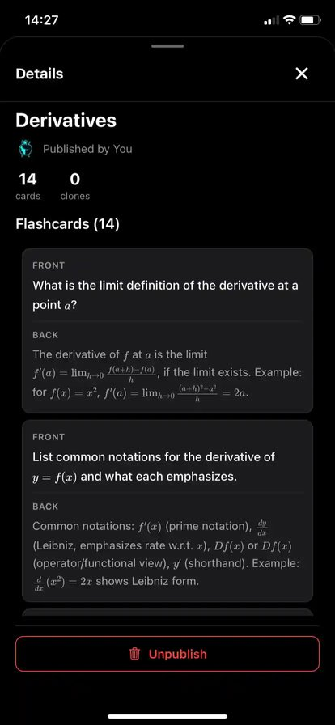 Shared library</td>
  </tr>
</table>

### Website

### Web app

<table>
  <tr>
    <td align="center">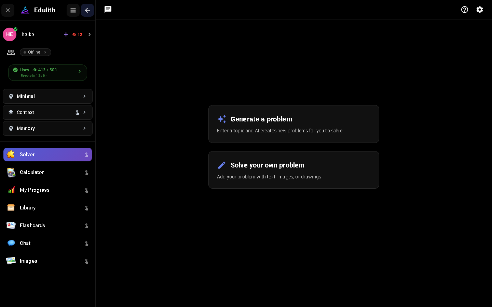 Solver</td>
    <td align="center">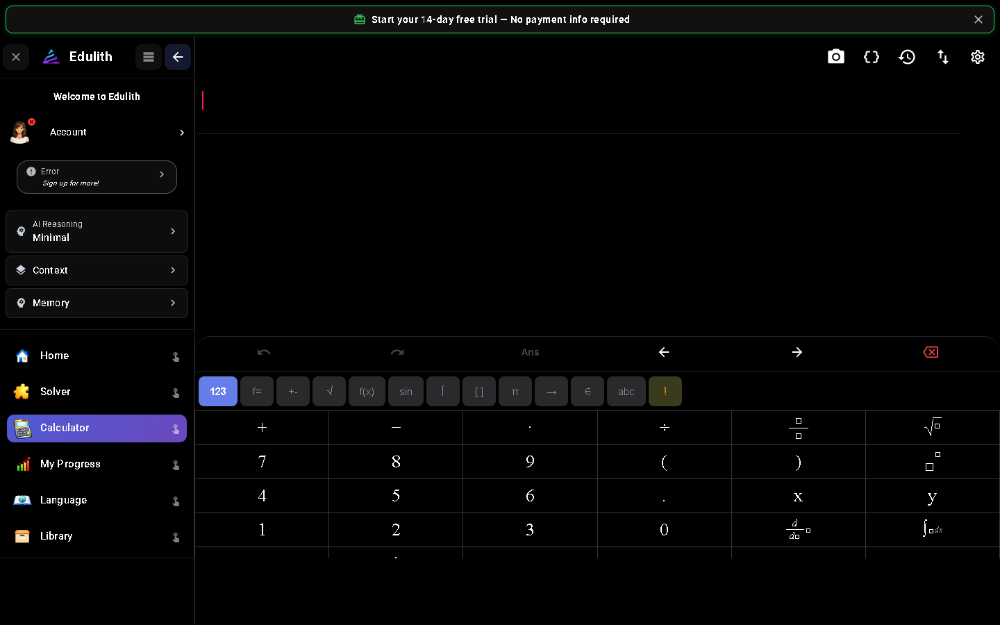 Calculator with math keyboard</td>
  </tr>
  <tr>
    <td align="center">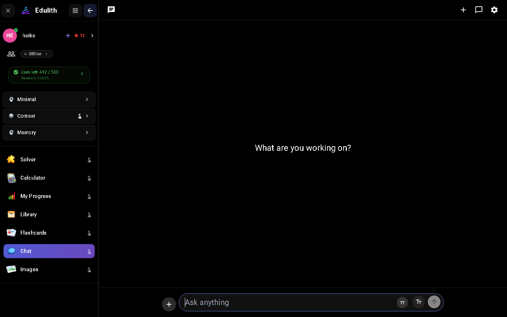 AI chat</td>
    <td align="center">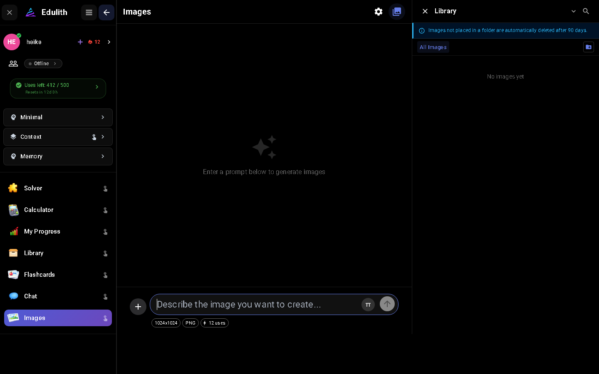 Image generation</td>
  </tr>
</table>

## What I built

- **Mobile app** in React Native and Expo for iOS and Android.
- **Web app** in React and TypeScript, packaged as a desktop app with Electron.
- **Marketing website** with landing pages and SEO.
- **Backend API** in Node.js and Express with Prisma and MySQL, real time features with Socket.io, payments with Stripe, and AI features through the OpenAI and Anthropic APIs.
- **Infrastructure** on a VPS with Docker, Traefik and GitHub Actions for build, staging and production deployments.

## What it does

- Solves math problems from text, drawing or a photo, and explains each step.
- Checks your own solution and gives feedback on what to improve.
- Calculator with a custom math keyboard, history, unit conversion and graphing.
- Generates flashcard decks from a topic and tracks progress while you study.
- Library where users can publish and clone study material.
- Accounts, friends, usage limits and subscription plans.

## Tech

React Native, Expo, React, TypeScript, Electron, Node.js, Express, Prisma, MySQL, Socket.io, Stripe, Docker, Traefik, GitHub Actions, Three.js.

## About

I built Edulith mainly by directing AI coding tools, planning what to build, reviewing the results and fixing what was wrong. It taught me a lot about structuring a larger codebase, reusing code across platforms and running a service in production.

Heike Håland Østensen, Norway
[LinkedIn](https://www.linkedin.com/in/heike-h%C3%A5land-%C3%B8stensen-531756405/)
